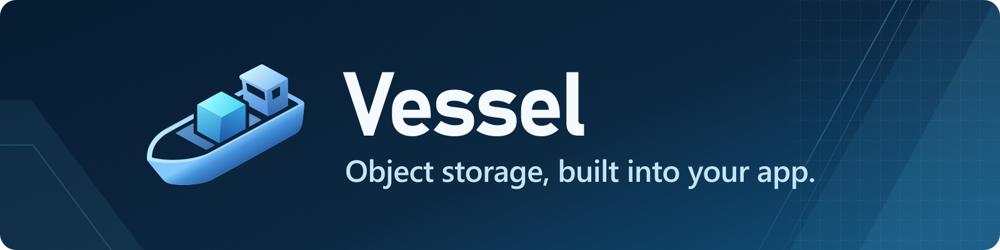

<h1>
  
</h1>

Vessel is a lightweight, embedded object store for local filesystems. It runs in your application process and stores byte streams under logical keys, with optional file metadata and per-object compression.

## Why Vessel?

Applications that keep documents, media or other binary data on disk often need to look up metadata, list related objects and replace content without interrupting readers. Vessel gives those applications a single storage API and manages how metadata and payloads are committed and recovered.

Vessel is designed to keep memory use predictable while streaming large objects and to avoid the overhead of running a separate storage service.

- **Stream large objects.** Read and write payloads incrementally. Look up metadata and list keys by prefix without opening payloads.
- **Control disk usage.** Choose LZ4, Zstd or uncompressed storage for each object. Identical payloads written with the same codec share a blob.
- **Embed the same engine across languages.** Use the managed library from .NET 8 or .NET 10, or load the NativeAOT shared library through its C ABI.

## Quick start

Reference `Vessel.Core` from a .NET 8 or .NET 10 console project, then put this in `Program.cs`. It creates `my-store`, writes a text object and reads it back.

~~~csharp
using System;
using System.IO;
using System.Text;
using Vessel;

using var storage = new VesselStorage("my-store");
using var input = new MemoryStream(Encoding.UTF8.GetBytes("Hello from Vessel!"));
var metadata = await storage.PutAsync("documents/hello.txt", input, overwrite: true);

await using var content = storage.GetStream(metadata.Key);
using var reader = new StreamReader(content, Encoding.UTF8, leaveOpen: true);
Console.WriteLine(await reader.ReadToEndAsync());
~~~

Follow the [C# guide](Docs/UserGuide/CSharp/README.md) to set up a project, the [C guide](Docs/UserGuide/C/README.md) to link a native client, or the [Python guide](Docs/UserGuide/Python/README.md) to install `vessel-storage` with its bundled native library.

For published versions, find the native C archives, NuGet package and Python wheels in [GitHub Releases](https://github.com/noyzone99/Vessel/releases). The [user guide](Docs/UserGuide/README.md) also links to NuGet.org and PyPI.

## Build from source

Install the .NET 10 SDK and run these commands from the repository root. The last command publishes the native library for Windows x64 and requires the target C++ toolchain. Choose a runtime identifier matching your target system for other builds.

~~~sh
dotnet build Vessel.slnx -c Release
dotnet pack Sources/Vessel.Core -c Release
dotnet publish Sources/Vessel.Native -c Release -r win-x64
~~~

The NuGet package goes to `Sources/Vessel.Core/bin/Release/Packages/`. The native binary and header go to `Sources/Vessel.Native/bin/Release/net10.0/<RID>/publish/`. See the [source build guide](Docs/UserGuide/BuildFromSource.md) for toolchains, Windows, Linux and macOS targets, tests and benchmarks.

## Documentation

- [Documentation index](Docs/README.md)
- [User guide](Docs/UserGuide/README.md)
- [API references](Docs/ApiReferences/README.md)
- [Storage behavior and recovery](Docs/UserGuide/Storage.md)

## Acknowledgments

Thanks to the maintainers and contributors of the projects that Vessel relies on.

- Object metadata indexing and persistence use [ZoneTree](https://github.com/ZoneTree/ZoneTree).
- LZ4 payload compression uses [K4os.Compression.LZ4 and K4os.Compression.LZ4.Streams](https://github.com/MiloszKrajewski/K4os.Compression.LZ4).
- Zstandard payload compression uses [`ZstdSharp.Port`](https://github.com/oleg-st/ZstdSharp).
- Performance benchmarks use [BenchmarkDotNet](https://github.com/dotnet/BenchmarkDotNet).

## License

Vessel is licensed under the [MIT License](LICENSE).
